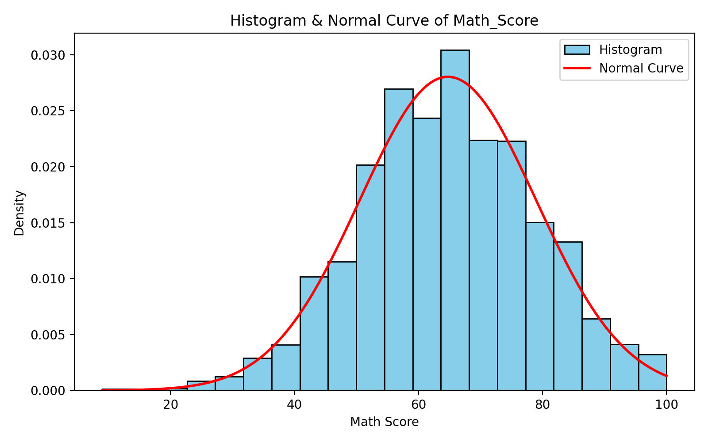
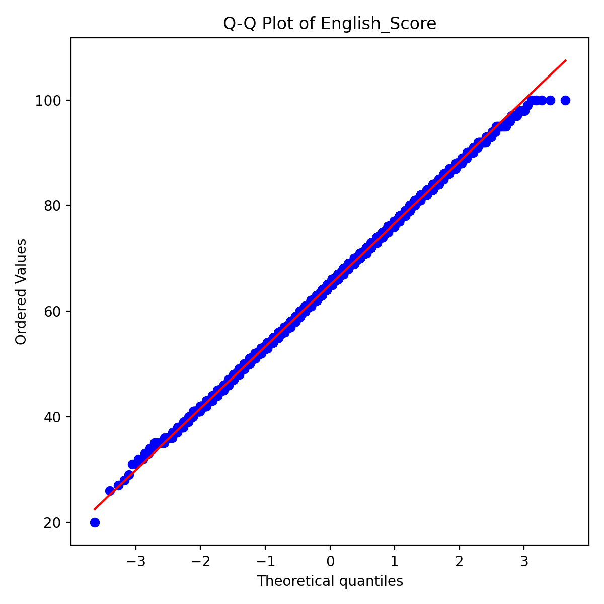

# 🎓 Student Scores Analysis
### Mini Research Report: Statistics, Probability & Linear Algebra with Python

### ▶️ [Watch the Video Presentation](https://drive.google.com/file/d/1_QMmvWSWilYgYmjCosZ4OYp0Pp5TYo6G/view?usp=sharing)

---

## 📑 Table of Contents

1. [About the Project](#-about-the-project)
2. [Dataset](#-dataset)
3. [Part A: Theory](#-part-a--theory)
4. [Part B: Practical Results](#-part-b--practical-results)
5. [Key Insights](#-key-insights)
6. [Video Presentation](#-video-presentation)

---

## 📌 About the Project

This project is a **mini research report** on a student performance dataset of about 5000 records. It has two parts:

- **Part A (Theory):** 8 short questions on core statistics, probability and linear algebra concepts, answered with simple explanations, formulas and examples from the dataset.
- **Part B (Practical):** Python implementation of those concepts on the dataset: central tendency, dispersion, probability, distributions, visualisation and vector operations.

The work was done to answer one practical question: **how do study hours and subject scores relate to passing?**

---

## 📊 Dataset

| Column | Description | Type |
|---|---|---|
| `Student_ID` | Unique ID of the student (1 to 5000) | int |
| `Age` | Age of the student (15 to 18 years) | int |
| `Math_Score` | Marks in Mathematics (0 to 100) | int |
| `Science_Score` | Marks in Science (0 to 100) | int |
| `English_Score` | Marks in English (0 to 100) | int |
| `Hours_Studied` | Study hours (0 to 12) | float |
| `Pass_Fail` | Result: `1` = Pass, `0` = Fail | int |

- **Rows:** 5000 &nbsp;|&nbsp; **Columns:** 7 &nbsp;|&nbsp; **Missing values:** 0 &nbsp;|&nbsp; **Duplicate rows:** 0

---

## 📝 Part A: Theory

Answers (with formula, example and conclusion) are in [`Report/Part_A_Student_Scores_Analysis_Theory.docx`](Report/Part_A_Student_Scores_Analysis_Theory.docx).

| # | Topic |
|---|---|
| 1 | Mean, Median and Mode |
| 2 | Variance vs Standard Deviation |
| 3 | Normal Distribution and a practical use case |
| 4 | Skewness and Kurtosis |
| 5 | Probability: Empirical vs Theoretical |
| 6 | Independent vs Dependent Events |
| 7 | Intuition of Bayes' Theorem |
| 8 | Eigenvalue and Eigenvector |

---

## 💻 Part B: Practical Results

### Step 1: Central Tendency & Dispersion

| Column | Measure | Result |
|---|---|---|
| `Math_Score` | Mean | **64.74** |
| `Math_Score` | Median | **65** |
| `Math_Score` | Mode | **62** (appears 148 times) |
| `Science_Score` | Range | **86** (100 − 14) |
| `Science_Score` | Variance | **204.63** |
| `Science_Score` | Standard Deviation | **14.31** |

> Mean, median and mode of Math are very close, so the scores are balanced around the centre.

### Step 2: Probability Basics

- **P(Pass)** = 3440 / 5000 = **0.688 (68.8%)**

**Contingency table: Pass_Fail vs Hours_Studied > 5**

| Pass_Fail | Hours ≤ 5 | Hours > 5 | Total |
|---|---:|---:|---:|
| Fail (0) | 1367 | 193 | 1560 |
| Pass (1) | 1237 | 2203 | 3440 |
| **Total** | 2604 | 2396 | 5000 |

- **P(Pass | Hours > 5)** = 2203 / 2396 = **0.9194 (91.94%)**
- For comparison, P(Pass | Hours ≤ 5) = 1237 / 2604 = 0.4750

### Step 3: Distribution & Visualization

 

*Left: Math_Score histogram with normal curve. Right: Q-Q plot of English_Score.*

| Check | Result | Reading |
|---|---|---|
| Math histogram + normal curve | Bell-shaped, fits the curve | Approximately normal |
| Science skewness | **−0.023** | Almost symmetric |
| Science kurtosis (excess) | **−0.081** | Normal-like tails |
| English Q-Q plot | Points close to the line | Approximately normal |

### Step 4: Linear Algebra Mini Task

Vectors of the first 5 students:
`Math a = [75, 66, 72, 72, 56]` and `Science b = [54, 57, 58, 65, 63]`

| Operation | Result |
|---|---|
| Dot product `a · b` | **20196** |
| Norm 1 of `a` (sum of absolute values) | **341** |
| Norm 2 of `a` (square root of sum of squares) | **153.25** |
| `cos θ` | 0.9899 |
| Angle between `a` and `b` | **8.14°** (0.1421 rad) |

> A very small angle means the Math and Science vectors are almost parallel: both subjects follow a similar pattern.

---

## 💡 Key Insights

1. 📈 About **69%** of the students passed (3440 out of 5000).
2. ⏱️ Students who study **more than 5 hours have about a 92% chance of passing**, compared with only about 48% for the others.
3. 🔔 Math and English scores are approximately normally distributed, and Science scores are almost symmetric (skewness and kurtosis near 0).
4. 📐 The angle between the Math and Science vectors is only **8.14°**, so performance in both subjects is closely related.

---

## 🎬 Video Presentation

A video explaining Part B step by step (setup, the four steps, results and conclusion):

👉 **[Watch on Google Drive](https://drive.google.com/file/d/1_QMmvWSWilYgYmjCosZ4OYp0Pp5TYo6G/view?usp=sharing)**

The slides used in the video are in [`Report/Part_B_Video_Presentation.pptx`](Report/Part_B_Video_Presentation.pptx).

---

## 👨‍💻 Author

**Manav Patel**
📧 manavpatel.tech@gmail.com
🔗 [GitHub](https://github.com/techmanavp) 

---